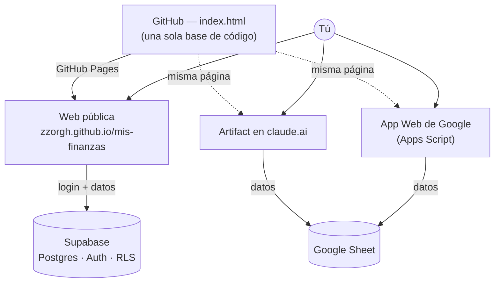

# Arquitectura

Una sola base de código corre en tres entornos; cada uno usa su propia capa de datos.
La web pública usa Supabase (login + base de datos con seguridad por usuario).

## Cómo decide la app su backend

Al cargar, la página detecta su entorno y elige la capa de datos:

1. **Apps Script** (`google.script.run` existe) → lee/escribe tu Google Sheet.
2. **claude.ai** (`window.claude` existe) → usa el conector de Google Sheets.
3. **Web pública** (ninguno de los anteriores, Supabase disponible) → login + Supabase.
4. **Sin nada de lo anterior** → solo el navegador (localStorage) + respaldo.

Toda la lógica de sincronización pasa por una interfaz común (`backend.read` /
`backend.write` / `backend.stamp`), así que agregar un entorno no toca las funciones
del producto.

## Datos

- **Web/Supabase:** tabla `estado` (un registro por usuario) con `registro`, `config`
  y `layout` en JSON. Row-Level Security: cada cuenta solo ve lo suyo.
- **Google Sheet:** pestañas `Registro` (un movimiento por fila) y `Config`.
- **Respaldo:** exportación/restauración en JSON, común a todos los entornos.

## Piezas de la web pública (nov. 2026)

- `index.html`: la app completa.
- `reportes.js`: arma los reportes PDF y Excel en un Web Worker, para no congelar la pantalla.
- `sw.js`: service worker; páginas «red primero», recursos estáticos «caché primero».
- **Supabase:** tablas `estado` y `estado_historial` (copia diaria, 30 días) con seguridad por fila, `lista_espera` (beta por invitación: solo correos aprobados pueden crear cuenta) y límites de tamaño. El SQL está en `supabase/`.
- **Sincronización:** copia local en el navegador, subida con espera corta, reintentos con espera creciente y tiempo límite; los datos que llegan (nube, respaldo o almacenamiento local) se normalizan antes de usarse.
